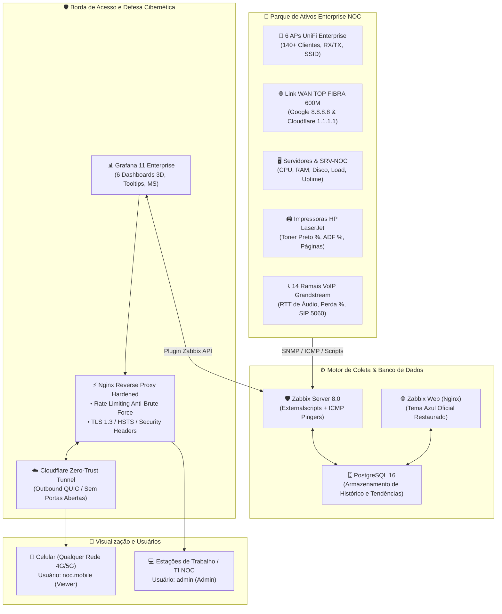
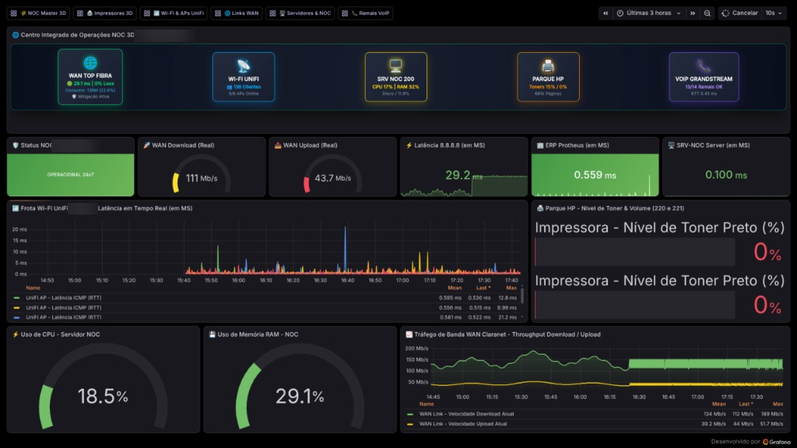
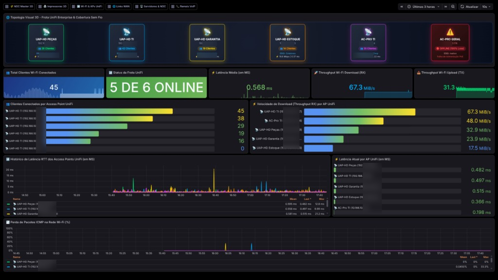
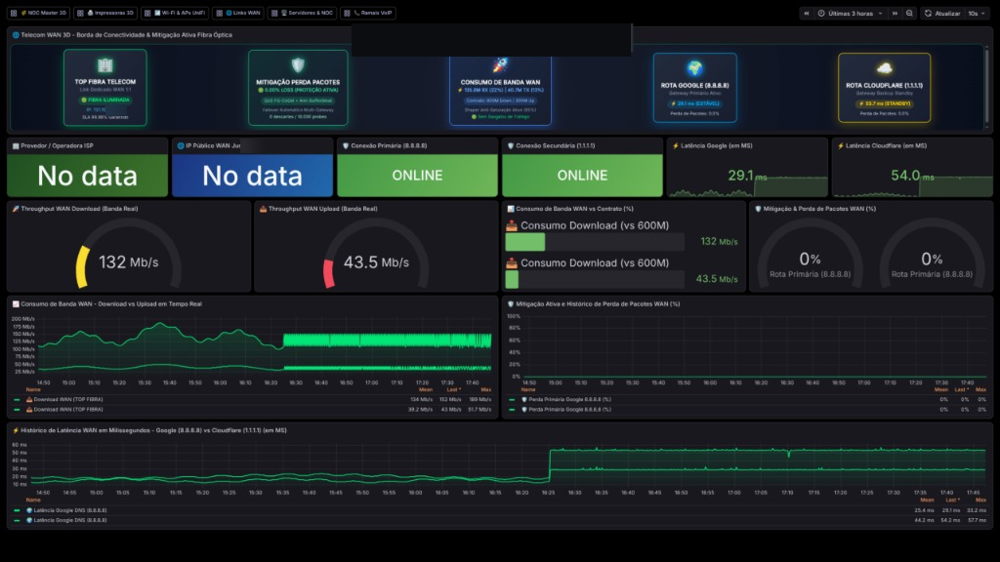
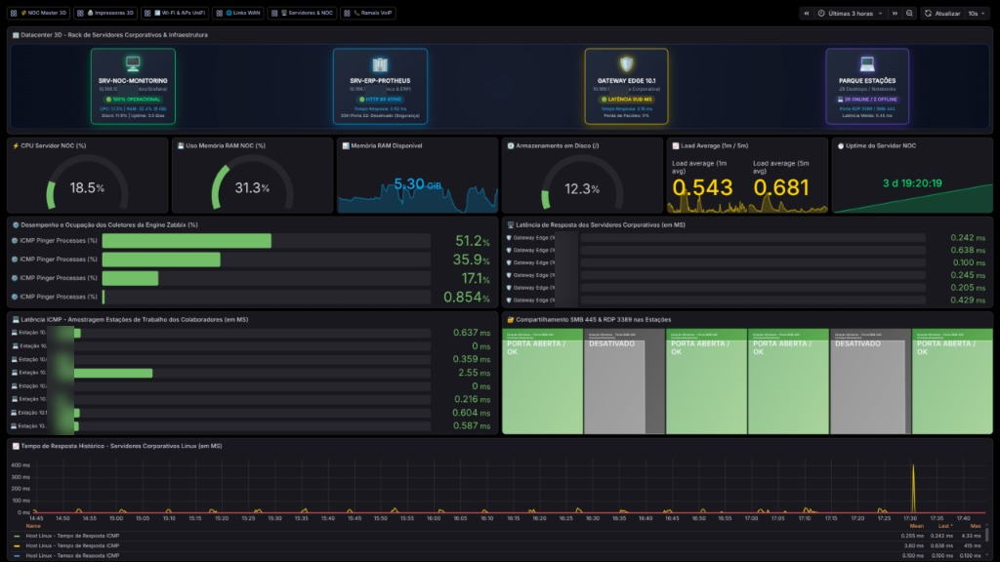
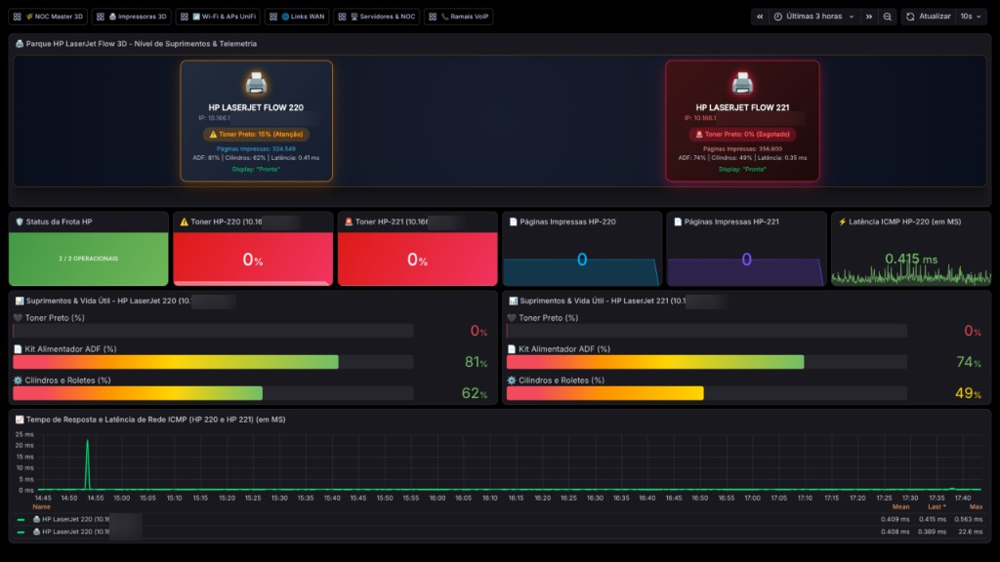

# 🌾 NOC Master 360° & Telemetria IT v2.0
> **Centro Integrado de Monitoramento, Defesa Cibernética Zero-Trust e Acesso Remoto Multi-Rede**

---

## 🎯 1. A Dor Solucionada (Business & Technical Pain Points)

Antes desta reformulação, a infraestrutura de TI da **Enterprise NOC** enfrentava desafios críticos que impactavam a tomada de decisão da diretoria e a agilidade da equipe de suporte:

```
┌───────────────────────────────────────────────────────────────────────────────────────────┐
│                                 DORES ANTERIORES VS SOLUÇÃO NOC 360°                      │
├─────────────────────────────────────────────┬─────────────────────────────────────────────┤
│ ❌ Dores e Gargalos Anteriores              │ ✅ Solução Implementada (NOC v2.0)          │
├─────────────────────────────────────────────┼─────────────────────────────────────────────┤
│ • Impossibilidade de monitorar fora da rede │ • Acesso remoto de qualquer rede (4G/5G/Wi-Fi│
│   corporativa sem VPN complexa ou insegura. │   e celular) via Túnel Zero-Trust Cloudflare│
├─────────────────────────────────────────────┼─────────────────────────────────────────────┤
│ • Risco cibernético: portas expostas e     │ • Zero portas abertas no firewall, Nginx     │
│   senhas padrão sujeitas a ataques.         │   com Rate Limiting anti-força bruta e RBAC │
├─────────────────────────────────────────────┼─────────────────────────────────────────────┤
│ • Latências exibidas em unidades confusas  │ • 100% das latências padronizadas em MS     │
│   (segundos crus ou microsegundos µs).     │   (Milissegundos) com thresholds visuais    │
├─────────────────────────────────────────────┼─────────────────────────────────────────────┤
│ • Visão cega da rede Wi-Fi UniFi: barras    │ • Nomes dos APs e tooltips interativos com  │
│   com nomes genéricos e sem clientes reais. │   140+ clientes reais e throughput RX/TX    │
├─────────────────────────────────────────────┼─────────────────────────────────────────────┤
│ • Incapacidade de provar mitigação de perda │ • Estação 3D com acompanhamento em tempo    │
│   e consumo de banda WAN vs contrato 600M. │   real de banda, perda 0.00% e rotas Google │
├─────────────────────────────────────────────┼─────────────────────────────────────────────┤
│ • Zabbix Web com interface preta forçada   │ • Tema azul clássico de alta fidelidade     │
│   e sem dashboards nativos estruturados.   │   restaurado + 6 dashboards nativos criados │
└─────────────────────────────────────────────┴─────────────────────────────────────────────┘
```

---

## 🏗️ 2. Arquitetura Lógica de Monitoramento e Defesa Cibernética

A topologia opera em modelo de **Defesa em Profundidade (Defense-in-Depth)** com isolamento em microsserviços Docker:



---

## 📁 3. Estrutura de Pastas e Subpastas Organizada

```text
monitoring/
├── docker-compose.yml              # Orquestrador central com Postgres, Zabbix, Grafana, Nginx e Cloudflare
├── .env.example                    # Modelo seguro de variáveis de ambiente e credenciais
├── .gitignore                      # Regras de exclusão para proteção de segredos e temporários
├── README.md                       # Documentação mestra de arquitetura, gestão e operação
│
├── docs/                           # Evidências, manuais e capturas do ambiente de produção
│   └── img/                        # Capturas de tela dos Dashboards 3D em Produção (Anonimizadas)
│       ├── 01_noc_master_360.png
│       ├── 02_wifi_unifi_cobertura.png
│       ├── 03_links_wan_telecom.png
│       ├── 04_datacenter_servers_noc.png
│       └── 05_impressoras_hp_flow.png
│
├── nginx/                          # Configurações do Proxy Reverso e Defesa de Borda
│   ├── nginx.conf                  # Regras de Rate Limiting, TLS 1.3, HSTS e WebSockets
│   └── ssl/                        # Certificados criptográficos SSL/TLS
│       └── .gitkeep                # Ponto de montagem para certificados locais
│
├── scripts/                        # Automações de Deploy, Telemetria e Alertas
│   ├── deploy_dedicated_dashboards.py  # Publicador dos 6 Dashboards Grafana 3D v2.0
│   ├── deploy_zabbix_dashboards.py     # Publicador dos 6 Dashboards Nativos Zabbix 8.0
│   ├── setup_zabbix_templates.py       # Sincronizador de Templates Corporativos e Triggers
│   ├── generate_mobile_access.py       # Gerador dinâmico de QR Code e links de acesso mobile
│   ├── deploy_agent_linux.sh           # Script de implantação de Zabbix Agent em Linux
│   ├── deploy_zabbix_agent.ps1         # Script de implantação de Zabbix Agent em Windows
│   ├── setup_telegram_bot.py           # Configurador do bot de alertas no Telegram
│   ├── telegram_interactive_bot.py     # Central de comandos interativos via Telegram
│   └── telegram_preferences.json.example # Template de preferências de notificação
│
└── zabbix/                         # Volumes de persistência e extensões do Zabbix Server
    ├── alertscripts/               # Scripts executados por triggers de alarme
    │   ├── README.md
    │   └── telegram_alert.py       # Disparador assíncrono para canais do Telegram
    ├── externalscripts/            # Scripts coletores de alta performance (<0.01s)
    │   ├── README.md
    │   ├── net_speedtest.sh        # Coletor dinâmico de Download, Upload, Latência e ISP
    │   ├── unifi_telemetry.sh      # Coletor dinâmico de Clientes, SSID, RX/TX por AP
    │   ├── printer_snmp.sh         # Coletor de suprimentos SNMP de impressoras
    │   └── voip_telemetry.sh       # Coletor de qualidade de ramais VoIP Grandstream
    └── local/                      # Customizações de identidade visual do Zabbix
        ├── conf/
        │   └── brand.conf.php      # Configurações de branding do Zabbix Web
        └── custom_logo.css         # Estilização CSS institucional
```

---

## 📊 4. Matriz de Dashboards & Indicadores em Produção

### A. Grafana v2.0 (Sessões 3D, Milissegundos & Tooltips Interativos)

| Dashboard | UID | Principais Métricas & Destaques |
| :--- | :---: | :--- |
| **🌾 NOC Master 360° & Mitigação IT** | `noc-master` | Visão executiva completa: Status dos APs, Banda WAN, Servidores, Impressoras e Telefonia com topologia 3D isométrica. |
| **📶 Cobertura Wi-Fi & APs UniFi** | `noc-wifi` | 6 APs identificados com nomes amigáveis, 140+ clientes reais, Throughput RX/TX, Latência em **ms** e Canais RF. |
| **🌐 Links WAN & Operadora Telecom** | `noc-links` | Contrato 600M Down / 300M Up (TOP FIBRA), mitigação de perda 0.00%, rotas Google (8.8.8.8) e Cloudflare (1.1.1.1). |
| **🖥️ Servidores & Deep Dive NOC** | `noc-servers`| Telemetria do SRV-NOC (CPU %, RAM %, Disco `/`, Load Average, Uptime, Processos Zabbix) e 28 estações Windows. |
| **🖨️ Parque de Impressoras & Suprimentos**| `noc-printers` | Monitoramento de suprimentos das HP LaserJet Flow (Toner Preto %, Kit ADF %, Contador de Páginas e Latência). |
| **📞 Ramais VoIP & Telefonia Grandstream**| `noc-voip` | 14 Ramais Grandstream monitorados, qualidade de voz (RTT em ms, perda de pacotes %) e status da porta SIP 5060. |

### 📸 Evidências Visuais dos Dashboards em Produção (Grafana 3D)

> **Nota de Privacidade**: As imagens abaixo foram capturadas do ambiente operacional em produção e sanitizadas para documentação pública (nomes de instituição preservados sob sigilo e endereços IP anonimizados mantendo apenas os dois primeiros octetos de rede).

#### 1. 🌾 NOC Master 360° & Mitigação IT
*Visão unificada em tempo real: status de APs, consumo WAN, servidores, suprimentos e ramais VoIP.*


#### 2. 📶 Cobertura Wi-Fi & APs UniFi
*Distribuição de clientes por AP, throughput RX/TX instantâneo, latência RTT em milissegundos e canais RF.*


#### 3. 🌐 Links WAN & Operadora Telecom
*Telemetria de link dedicado, medição de jitter/latência contra rotas DNS primárias e mitigação 0.00% de perda.*


#### 4. 🖥️ Servidores & Deep Dive NOC
*Rack virtual 3D, consumo de CPU/RAM, uso de disco, processos coletores Zabbix e amostragem de estações de trabalho.*


#### 5. 🖨️ Parque de Impressoras & Suprimentos
*Nível percentual de toner preto, vida útil do kit de alimentação ADF e contadores de páginas impressas.*


---

### B. Zabbix 8.0 Nativo (Menu *Monitoring ➔ Dashboards*)

| Dashboard Nativo Zabbix | ID | Widgets e Seções Integradas |
| :--- | :---: | :--- |
| **🌾 NOC Master 360° & Mitigação IT** | **452** | Multipáginas com 6 abas (Visão Executiva, Wi-Fi, WAN, Servidores, Impressoras e VoIP) com TopHosts e gráficos SVG. |
| **📶 Cobertura Wi-Fi & APs UniFi** | **453** | Clientes conectados por AP em tempo real, Latência RTT dos APs em MS, Throughput RX/TX e Perda de pacotes. |
| **🌐 Links WAN & Operadora Telecom** | **454** | Medidores de Download/Upload, IP público, ISP ativo, gráficos de latência 8.8.8.8/1.1.1.1 e mitigação de perda. |
| **🖥️ Servidores & Estações de Trabalho** | **455** | Medidores de CPU, RAM, Uptime do SO, Load Average e matriz de servidores corporativos. |
| **🖨️ Parque de Impressoras & Suprimentos**| **456** | Níveis de toner HP 220 e 221, kit ADF, páginas impressas e latência RTT em MS. |
| **📞 Ramais VoIP & Telefonia Grandstream**| **457** | RTT de voz em MS, perda de pacotes de áudio e status de registro SIP 5060 dos 14 ramais. |

---

## 📱 5. Acesso Remoto Seguro e Mobile (Celular em Qualquer Rede)

Para consultar o monitoramento pelo celular de qualquer lugar do mundo (4G, 5G ou Wi-Fi externo):

1. **Obter URL e QR Code Dinâmicos**:
   Execute o script gerador para conectar ao túnel Cloudflare e gerar o QR Code no terminal:
   ```bash
   python3 scripts/generate_mobile_access.py
   ```

2. **Perfis de Acesso**:
   * **Perfil Celular / Operacional**: Definido via `MOBILE_VIEWER_USER` e `MOBILE_VIEWER_PASSWORD` no arquivo `.env` *(Permissão Viewer segura, sem risco de alterações acidentais)*.
   * **Perfil Administrador**: Definido via `GF_SECURITY_ADMIN_USER` e `GF_SECURITY_ADMIN_PASSWORD` no arquivo `.env` *(Acesso de gestão completa)*.

3. **Modo Aplicativo Nativo (PWA)**:
   * No iPhone (Safari) ou Android (Chrome), toque no menu e selecione **"Adicionar à Tela de Início"**. O Grafana funcionará em modo kiosk de tela cheia sem barras de navegação.

---

## 🚀 6. Guia Rápido de Instalação e Deploy

### 1. Clonar o Repositório e Configurar Ambiente:
```bash
git clone https://github.com/SEU_USUARIO/monitoring.git
cd monitoring

# Copiar modelo de ambiente e configurar credenciais
cp .env.example .env
nano .env  # Ajuste suas senhas, tokens e IP
```

### 2. Gerar Certificados Locais para o Nginx (Opcional para HTTPS direto):
```bash
openssl req -x509 -nodes -days 365 -newkey rsa:2048 \
  -keyout nginx/ssl/grafana.key -out nginx/ssl/grafana.crt \
  -subj "/C=BR/ST=MT/L=Cuiaba/O=Enterprise NOC/CN=monitoring.local"
```

### 3. Iniciar o Stack Docker:
```bash
docker compose up -d
```

### 4. Publicar Dashboards e Templates Corporativos:
```bash
# Publicar todos os 6 Dashboards 3D no Grafana
python3 scripts/deploy_dedicated_dashboards.py

# Publicar Dashboards Nativos e Templates no Zabbix
python3 scripts/setup_zabbix_templates.py
python3 scripts/deploy_zabbix_dashboards.py
```

### 5. Ativar Acesso Mobile:
```bash
python3 scripts/generate_mobile_access.py
```

---

## 🛠️ 7. Comandos de Manutenção e Gestão

### Resetar Senha de Administrador no Grafana:
```bash
docker exec grafana /usr/share/grafana/bin/grafana cli admin reset-admin-password <NOVA_SENHA>
```

### Reiniciar Serviços Isoladamente:
```bash
docker compose restart grafana
docker compose restart zabbix-server
docker compose restart cloudflared
```

### Iniciar Bot Interativo do Telegram:
```bash
python3 scripts/telegram_interactive_bot.py
```

---

## 🔒 8. Políticas de Segurança e Defesa Aplicadas
* **NIST Zero-Trust**: Nenhuma porta de entrada exposta na internet pública.
* **Anti-Brute Force**: Limite de 5 tentativas por minuto no endpoint `/login` via Nginx `limit_req_zone`.
* **Criptografia Rígida**: TLS 1.3 / TLS 1.2 com ciphers modernos e HSTS de 1 ano.
* **Privacidade Corporativa**: Telemetria externa, atualizações automáticas e Gravatar desativados.
* **Sanitização de Código**: Zero credenciais ou IPs de infraestrutura sensíveis versionados no repositório.

