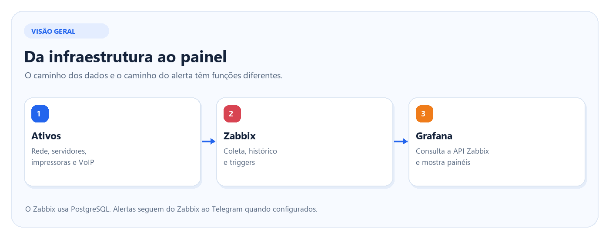
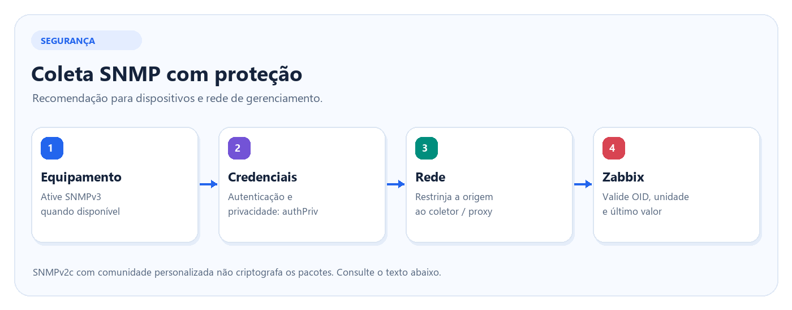
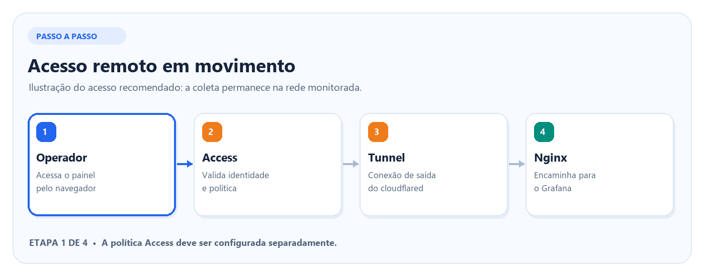
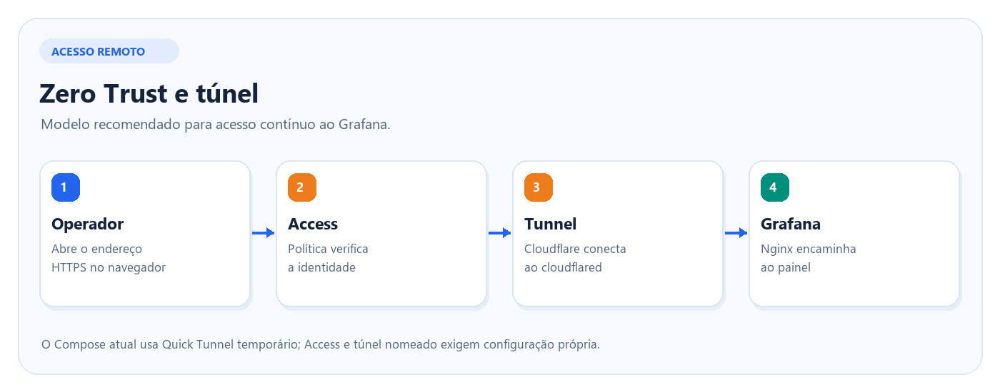
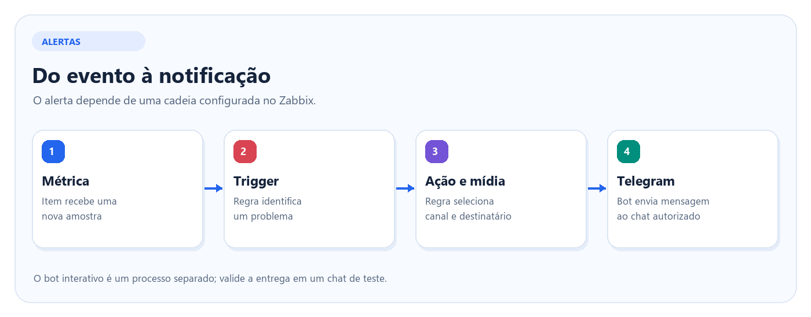
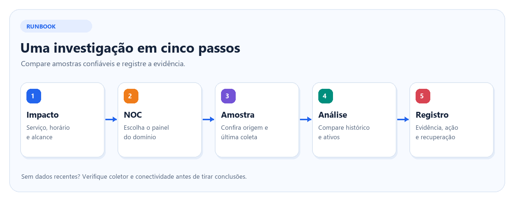

# NOC Master 360° | Monitoramento de TI

O NOC Master 360° centraliza a consulta de rede, Wi-Fi, servidores, impressoras e telefonia IP. O Zabbix coleta métricas e registra problemas. O Grafana reúne os indicadores em uma visão geral e cinco painéis dedicados. O repositório inclui o ambiente Docker, os publicadores dos painéis e scripts de apoio.

Este guia serve para quem monta um laboratório, administra a plataforma ou usa os painéis no atendimento de TI. A edição pública inclui dados de demonstração. Confira a origem de uma série antes de usá-la como evidência de um incidente.

## Índice

- [Como o projeto me ajudou](#como-o-projeto-me-ajudou)
- [Como o monitoramento funciona](#como-o-monitoramento-funciona)
- [Painéis e qualidade dos dados](#painéis-e-qualidade-dos-dados)
- [Instalação em laboratório](#instalação-em-laboratório)
- [Preparação da coleta](#preparação-da-coleta)
- [Publicação dos dashboards](#publicação-dos-dashboards)
- [Acesso remoto e Telegram](#acesso-remoto-e-telegram)
- [Runbook de atendimento](#runbook-de-atendimento)
- [Manutenção e recuperação](#manutenção-e-recuperação)
- [Mapa do repositório](#mapa-do-repositório)

## Como o projeto me ajudou

Na minha rotina de TI, o NOC me deu um ponto de partida para investigar chamados. Quando alguém relata lentidão, consigo abrir a visão geral, entrar no painel de WAN ou Wi-Fi e comparar o horário do relato com o histórico. Se o problema se concentra em um setor, posso começar pelo ponto de acesso daquele local. Se aparece em vários setores ao mesmo tempo, passo a investigar a infraestrutura compartilhada.

Também consigo documentar melhor o que observei. No chamado, posso registrar o ativo, a janela de tempo, a métrica e o horário da última coleta. Isso dá à próxima pessoa do plantão um ponto de partida para continuar a investigação e me ajuda a explicar o problema à equipe responsável ou à operadora.

Versionar os publicadores me ajuda a manter os dashboards. Posso revisar filtros e parâmetros no Git, entender de onde vem um indicador e reproduzir a organização dos painéis em um laboratório. Os cinco atalhos do NOC Master deixam a navegação entre a visão geral e os domínios mais rápida, inclusive pelo teclado.

## Como o monitoramento funciona

O Zabbix coleta informações diretamente dos ativos ou recebe dados dos agentes e grava o histórico no PostgreSQL. O Grafana consulta a **API do Zabbix** pela fonte de dados para apresentar os painéis. Em paralelo, uma trigger pode gerar um evento e uma ação configurada pode enviar um alerta ao Telegram. O túnel trata do acesso remoto ao Grafana; ele não realiza a coleta SNMP.

| Componente | Papel no projeto | O que conferir primeiro |
| --- | --- | --- |
| Zabbix Server | Executa checagens, recebe dados de agentes e avalia gatilhos | Saúde do coletor e horário do último valor |
| Zabbix Web e API | Interface de configuração, histórico e acesso por aplicações | Permissões do usuário, cadastro dos hosts e acesso à API |
| PostgreSQL | Armazena configuração, histórico e eventos do Zabbix | Estado do banco, espaço em disco e retenção |
| Grafana | Consulta a fonte Zabbix e organiza os dashboards | Conexão da fonte de dados, filtros e período selecionado |
| Nginx | Publica a interface Grafana por HTTPS | Certificado, configuração do proxy e logs |
| Cloudflare Tunnel | Opção para acesso remoto ao Grafana | Estado do túnel e política de acesso configurada |
| Telegram | Canal opcional de alertas e consultas | Mídia, ação do Zabbix e controle dos destinatários |

No Zabbix, um **host** identifica o ativo monitorado e um **item** define o que coletar. O histórico guarda os valores com o horário da coleta. Uma **trigger** avalia o histórico ou o último valor para abrir um problema. O Grafana apresenta os itens autorizados pela fonte de dados, conforme o intervalo de tempo e os filtros de cada painel.

O Compose usa volumes para a persistência do banco e do Grafana. Na atualização de imagens, confira as tags em `docker-compose.yml` e registre as versões que foram testadas. O agente local tem acesso ampliado ao host e deve ser ativado de acordo com a coleta que o laboratório precisa.

## Painéis e qualidade dos dados

| Painel | Use quando precisar | Confirme antes de concluir |
| --- | --- | --- |
| NOC Master 360° | Identificar o domínio que merece atenção e abrir o painel dedicado | Os cards principais são atalhos. Os widgets abaixo consultam itens configurados |
| Links WAN | Investigar perda, latência e capacidade do link | A origem da série e o destino da checagem |
| Wi-Fi UniFi | Comparar disponibilidade e RTT entre pontos de acesso | O AP do local afetado e a origem das métricas de clientes e tráfego |
| Servidores e NOC | Investigar CPU, RAM, disco, disponibilidade e uptime | A última coleta do agente, a janela do gráfico e a unidade |
| Impressoras HP | Investigar conectividade, suprimentos e volume de impressão | A resposta SNMP e a unidade retornada pelo equipamento |
| Ramais VoIP | Separar falha de alcançabilidade de falha de telefonia | O estado do registro no PABX e a fonte usada para medir a chamada |

O publicador também cria seis dashboards nativos no Zabbix. Acesse **Monitoring → Dashboards** e use os IDs retornados pelo script na sua instância. As visualizações nativas e as do Grafana podem exibir o mesmo domínio com filtros e janelas diferentes.

### Medição, demonstração e validação

| Fonte | Comportamento do código publicado | Uso no atendimento |
| --- | --- | --- |
| Itens ICMP e Zabbix Agent | Coletam dados do ambiente quando o host e os itens estão configurados | Confira a hora da amostra e o ponto de vista do coletor |
| `net_speedtest.sh` | Gera números de demonstração para indicadores de banda, latência e perda | Use a série de uma medição real de interface, sonda ou teste de velocidade para analisar desempenho |
| `unifi_telemetry.sh` | Gera valores de demonstração para clientes, SSID, tráfego e rádio | Use dados da controladora ou de uma coleta validada para diagnosticar saturação |
| `printer_snmp.sh` | Consulta OIDs via SNMP. Algumas falhas devolvem um valor padrão | Confirme a resposta do equipamento antes de interpretar zero ou o texto de status |
| `discover_printers.py` | Sonda portas de candidatos. As informações exibidas de modelo, serial e toner são de exemplo | Valide o equipamento no inventário ou por SNMP antes de cadastrá-lo |
| `voip_telemetry.sh` | Testa alcançabilidade TCP de serviços. A opção de uptime usa um valor fixo quando a porta responde | Use o PABX para verificar o registro e uma fonte de mídia para analisar a qualidade da chamada |
| Cards decorativos dos painéis dedicados | Exibem texto definido no gerador do dashboard | Use gráficos ligados a itens para avaliar o estado atual |

**Como ler a série.** Em **Monitoring → Latest data**, confira o host, a chave do item, a unidade e a última atualização. Em um item ICMP, confirme se a latência aparece em segundos ou milissegundos e se existe conversão no pré-processamento. Compare amostras que tenham a mesma unidade e o mesmo período. A atualização da tela e a coleta do item têm frequências próprias.

## Instalação em laboratório

### 1. Preparar o ambiente

Use um host Linux com Docker Engine, Docker Compose v2, Python 3 e uma rede de laboratório que alcance somente os ativos previstos para teste. Planeje espaço em disco para o histórico, as tendências e os backups. Registre as versões das imagens e do plugin Grafana usadas na instalação.

~~~bash
git clone https://github.com/targino-tech/Motiroramento-T.I-.git
cd Motiroramento-T.I-
umask 077
test -f .env || cp .env.example .env
chmod 600 .env

docker compose version
python3 --version
~~~

Abra `.env` em um editor e preencha valores próprios para o ambiente. O Compose usa esse arquivo para preencher a configuração. Os scripts Python executados no host recebem as variáveis que você exportar no terminal em que os roda.

| Grupo de variáveis | Finalidade |
| --- | --- |
| `POSTGRES_USER`, `POSTGRES_PASSWORD`, `POSTGRES_DB` | Inicialização do banco e conexão do Zabbix |
| `GF_SECURITY_ADMIN_USER`, `GF_SECURITY_ADMIN_PASSWORD` | Inicialização do administrador Grafana e login usado pelo publicador |
| `GRAFANA_URL` | URL base usada pelo publicador do Grafana |
| `ZABBIX_API_URL`, `ZABBIX_USER`, `ZABBIX_PASS` | Endpoint e conta de publicação para os scripts de templates e dashboards do Zabbix |
| `MOBILE_VIEWER_USER`, `MOBILE_VIEWER_PASSWORD` | Valores que o gerador de acesso móvel imprime. A conta Viewer é cadastrada à parte no Grafana |
| `TELEGRAM_BOT_TOKEN` | Token lido pelo bot interativo e pelo script de envio de alertas quando configurado no ambiente do processo |

### 2. Validar o Compose e iniciar os serviços

~~~bash
docker compose config --quiet
docker compose config --services
~~~

1. Confira os mapeamentos de portas, volumes e serviços opcionais no Compose do seu laboratório.
2. Para iniciar o proxy HTTPS, disponibilize o certificado e a chave nos caminhos declarados em `nginx/nginx.conf`. Use um certificado confiável para o hostname de acesso.
3. Com `docker compose up -d`, passe os nomes listados para os serviços centrais que vai usar. Comece pelo banco, pelo Zabbix Server e Web, pelo Grafana e pelo proxy. Inicie agente local e túnel somente se fizerem parte do teste.
4. Consulte `docker compose ps` e os logs dos serviços iniciados. Confirme que o banco aceita conexões e que as interfaces Web respondem no ambiente de administração.
5. Na primeira configuração, troque as senhas iniciais e crie contas separadas para administração, leitura dos painéis e consumo da API.

## Preparação da coleta

### Proteção da coleta SNMP

**Situação do código publicado:** `zabbix/externalscripts/printer_snmp.sh` usa SNMPv2c e tem a comunidade `public` definida no próprio script. Alterar a comunidade na interface do Zabbix não altera esse script externo. Antes de usá-lo fora do laboratório, adapte-o ou substitua a coleta por itens SNMP nativos e valide cada impressora. Este guia descreve uma recomendação; não altera a configuração dos equipamentos nem comprova que a proteção está ativa.

1. Quando o equipamento e o coletor suportarem, prefira **SNMPv3 com authPriv**. Crie um usuário de leitura com autenticação e privacidade, escolhendo algoritmos compatíveis e fortes oferecidos pelos dois lados, como SHA-256 e AES quando disponíveis.
2. Configure no host do Zabbix a interface SNMPv3 com o mesmo usuário, nível, protocolos e segredos. Use macros secretas ou um gerenciador de segredos adequado; não publique credenciais no Git. Confira os requisitos e compatibilidade na [documentação de itens SNMP do Zabbix](https://www.zabbix.com/documentation/current/en/manual/config/items/itemtypes/snmp).
3. Restrinja o acesso SNMP no equipamento e no firewall aos endereços do Zabbix Server ou proxy autorizado, em uma rede de gerenciamento. Limite o usuário aos OIDs necessários e somente leitura; desative comunidades padrão e acesso de escrita quando não forem necessários.
4. Valide um OID conhecido, a unidade e a última atualização em **Latest data**. Revise logs e teste a falha de credenciais ou a perda de comunicação em laboratório. Faça a mudança por equipamento para evitar interromper a coleta.

Se o dispositivo só suportar SNMPv2c, substitua `public` por uma comunidade exclusiva e difícil de adivinhar, restrinja a origem e use uma rede de gerenciamento isolada. **SNMPv2c transmite a comunidade e os dados sem criptografia**: renomear a comunidade reduz a exposição de uma credencial padrão, mas não protege o conteúdo dos pacotes contra interceptação nem garante integridade. A proteção de confidencialidade e integridade exige SNMPv3 `authPriv` ou outra proteção de transporte adequada. Consulte também a [explicação do Zabbix sobre SNMPv3](https://blog.zabbix.com/monitoring-network-hardware-with-snmpv3-in-zabbix/10093/).

### Preparar os ativos

1. Cadastre os grupos e os hosts no Zabbix. Defina a interface e a forma de coleta para cada ativo. Os publicadores usam nomes, chaves e IDs do ambiente de origem e precisam ser adaptados à sua instância.
2. Configure uma checagem de conectividade e uma métrica operacional por domínio. Comece por um ativo conhecido para comparar a leitura com o equipamento ou sistema de origem.
3. Para agentes Linux e Windows, passe o endereço do servidor ao instalador e confira a compatibilidade do pacote com o sistema. No Zabbix, o hostname do cadastro precisa corresponder ao nome usado pelo agente em checks ativos.
4. Para checks externos, valide as dependências dentro do ambiente que executa o script. A coleta SNMP usa `snmpget` e as sondas TCP usam `nc`. Confira alcance, permissão de execução, retorno e timeout.
5. Confirme valores recentes em **Latest data**. Se um item estiver como **Not supported**, abra o erro do item e repita a checagem a partir do Zabbix Server ou proxy responsável por ela.
6. Revise as triggers após observar a linha de base. Diferencie falha de conectividade, degradação sustentada e ausência de amostras. Use limites adequados ao ativo e ao impacto do serviço.

Para conferir o formato da descoberta de impressoras sem varrer a rede, use o modo de demonstração.

~~~bash
python3 scripts/discover_printers.py --test
~~~

Para uma faixa autorizada, consulte `python3 scripts/discover_printers.py --help` e use os parâmetros de faixa e concorrência. Confirme os resultados com o inventário ou com uma consulta SNMP validada.

## Publicação dos dashboards

### Grafana

1. Habilite o app **Zabbix** no Grafana e crie uma fonte de dados desse tipo. Configure o endpoint da API Zabbix alcançável pelo Grafana e uma conta ou token com leitura dos grupos monitorados.
2. Execute **Save & test**. Depois abra **Explore**, selecione a fonte e consulte um item que já tenha dados no Zabbix.
3. Confira o UID da fonte. Ajuste `DS_UID` no publicador se o valor da sua instância for diferente. Revise os filtros de hosts e itens que alimentam os widgets.
4. Exporte os dashboards em uso e rode o publicador. O script substitui as definições existentes quando encontra o mesmo UID.
5. Abra o NOC Master e teste os cinco atalhos por teclado e clique. Em cada painel, compare pelo menos uma série com o item correspondente no Zabbix.

[Configuração oficial da fonte de dados Zabbix no Grafana](https://grafana.com/docs/plugins/alexanderzobnin-zabbix-app/latest/configure/)

~~~bash
read -r -p 'URL de publicação Grafana: ' GRAFANA_URL
read -r -p 'Usuário Grafana: ' GF_SECURITY_ADMIN_USER
read -rs -p 'Senha Grafana: ' GF_SECURITY_ADMIN_PASSWORD
printf '\n'
export GRAFANA_URL GF_SECURITY_ADMIN_USER GF_SECURITY_ADMIN_PASSWORD

python3 scripts/deploy_dedicated_dashboards.py

unset GRAFANA_URL GF_SECURITY_ADMIN_USER GF_SECURITY_ADMIN_PASSWORD
~~~

### Zabbix

| Script | Revise antes de executar | Confira depois |
| --- | --- | --- |
| `setup_zabbix_templates.py` | Grupos, chaves, permissões e itens locais. O script pode remover itens avulsos que conflitam com o template | Templates vinculados, triggers esperadas e valores chegando em **Latest data** |
| `deploy_zabbix_dashboards.py` | Nomes e IDs dos grupos e itens. O script busca dashboards por nome e pode excluir os que correspondem ao filtro | IDs criados, disponibilidade dos widgets e associação com os itens corretos |

Faça backup da instância antes dessas operações. Em um laboratório já conferido, rode os scripts com o endpoint e as credenciais de publicação exportados. Em caso de erro, confira a última mudança aplicada antes de rodar novamente.

~~~bash
read -r -p 'URL da API Zabbix: ' ZABBIX_API_URL
read -r -p 'Usuário Zabbix: ' ZABBIX_USER
read -rs -p 'Senha Zabbix: ' ZABBIX_PASS
printf '\n'
export ZABBIX_API_URL ZABBIX_USER ZABBIX_PASS

python3 scripts/setup_zabbix_templates.py &&
  python3 scripts/deploy_zabbix_dashboards.py

unset ZABBIX_API_URL ZABBIX_USER ZABBIX_PASS
~~~

## Acesso remoto e Telegram

### Grafana no celular

Na sequência ilustrada, o operador acessa o endereço da aplicação, o Access aplica a política de identidade e a Cloudflare encaminha a requisição pela conexão estabelecida pelo `cloudflared` até o proxy e o Grafana. O conector inicia uma conexão de saída; o túnel sozinho não cria uma política de autenticação. Consulte os [fundamentos do Tunnel](https://developers.cloudflare.com/tunnel/concepts/).

Para acesso contínuo, configure um túnel nomeado e uma política no **Cloudflare Access** para as identidades autorizadas. Mantenha o papel **Viewer** para quem só precisa consultar os painéis. Valide o login pelo endereço HTTPS e teste a experiência no celular.

[Cloudflare Tunnel](https://developers.cloudflare.com/tunnel/get-started/) · [Cloudflare Access para aplicações web](https://developers.cloudflare.com/cloudflare-one/access-controls/applications/http-apps/)

O Compose inclui um Quick Tunnel para demonstração, com endereço temporário. Ele deve ser usado em laboratório. O gerador de acesso móvel lê a URL do túnel nos logs, cria um QR Code local e imprime informações de acesso. Execute-o em um terminal privado. O modo kiosk do Grafana permite abrir um painel em tela cheia pelo navegador.

[Quick Tunnels da Cloudflare](https://developers.cloudflare.com/tunnel/get-started/quick-tunnels/)

### Alertas e consultas por Telegram

O fluxo de alerta depende de um evento, uma ação no Zabbix, uma mídia e um destinatário. O bot interativo é um processo separado e consulta o Zabbix. Ele inclui pesquisa de hosts, preferências e ações de diagnóstico, como teste de impressão e teste de banda sob demanda.

- Confira o token e o destinatário no ambiente responsável pelo envio. Valide a entrega em um chat de teste antes de ativar alertas para a equipe.
- Revise as premissas de configuração do script antes de apontá-lo para outra instância. Use uma conta apropriada para o acesso à API.
- Antes de disponibilizar o bot interativo, configure controle de acesso por chat, substitua as credenciais padrão e delimite quais ações cada operador pode executar.
- A função de teste sob demanda depende de `speedtest-cli`. Ela é um fluxo separado dos valores exibidos pelo coletor de demonstração.

## Runbook de atendimento

### Durante um incidente

1. Registre o horário do relato, o serviço afetado e o alcance do problema.
2. Selecione a mesma janela no Grafana e no Zabbix. Verifique o fuso horário para alinhar o relato e o histórico.
3. Compare o valor atual com o comportamento anterior. Consulte **Problems** para identificar eventos correlatos e **Latest data** para validar a amostra de origem.
4. Registre no chamado a fonte, o item, a unidade, o horário e a checagem feita. Quando atuar, compare a janela de recuperação com a do incidente.

| Sintoma | Onde olhar primeiro | Como avançar |
| --- | --- | --- |
| Painel mostra `No data` | O mesmo item em **Latest data** | Confirme fonte, credenciais, filtros e período. Teste o item em **Explore** |
| Lentidão em vários setores | Histórico de latência, perda e disponibilidade | Compare destinos medidos e confirme se o tráfego no link mudou no mesmo período |
| Lentidão em um setor | Ponto de acesso do local | Compare disponibilidade e RTT com APs próximos. Consulte rádio e ocupação na controladora |
| Host sem amostras recentes | Serviço do agente e interface do host | Verifique nome, direção da coleta e alcance entre agente e coletor |
| Toner aparece como zero | Resposta SNMP do equipamento | Confira credencial, alcance, OID e unidade do modelo |
| Ramal falha com a porta acessível | Registro no PABX | Confira sinalização e caminho de mídia antes de tratar a falha como indisponibilidade do ramal |
| Grafana retorna ao login | Acesso pelo hostname HTTPS | Confira cookies, certificado, origem do proxy e logs |
| Alerta Telegram não chegou | Evento, ação e mídia no Zabbix | Valide o destinatário, o token e a conectividade do processo que envia |

## Manutenção e recuperação

### Atualização controlada

1. Registre as versões em execução, o estado dos serviços e o período normal de coleta.
2. Faça backup do PostgreSQL e do volume do Grafana. Exporte os dashboards antes de sobrescrevê-los.
3. Valide a atualização em laboratório antes de aplicá-la na instância em uso.
4. Depois da mudança, confira um item por domínio, a fonte de dados, os atalhos, o login e o fluxo de alertas.
5. Em caso de regressão, identifique se a mudança afetou configuração, dados ou imagem do serviço. Recupere a camada afetada conforme o backup testado.

### O que preservar

| Componente | Preserve | Valide a recuperação |
| --- | --- | --- |
| PostgreSQL | Backup do banco e política de retenção | Importe em uma instância de teste e confira configuração e histórico |
| Grafana | Volume de dados, configuração e exportações dos painéis | Confira usuários, conexões e consultas após restaurar |
| Configuração local | Variáveis e certificados em armazenamento autorizado | Confirme que as credenciais vigentes e o certificado funcionam no ambiente restaurado |
| Scripts e documentação | Revisão versionada dos publicadores | Compare a versão executada com o commit adotado pela equipe |

Use `docker compose ps` para ver o estado dos contêineres e `docker compose logs --tail=100` para a triagem inicial. Remover volumes apaga o estado persistente do ambiente. Guarde backups, tokens, credenciais, inventário e endereços internos no local definido pela equipe.

## Mapa do repositório

| Arquivo ou pasta | O que você encontra |
| --- | --- |
| [docker-compose.yml](docker-compose.yml) | Serviços, rede interna e persistência |
| [.env.example](.env.example) | Modelo de configuração local |
| [nginx/nginx.conf](nginx/nginx.conf) | Configuração do proxy, TLS e WebSockets |
| [scripts/deploy_dedicated_dashboards.py](scripts/deploy_dedicated_dashboards.py) | Definições e publicação dos seis dashboards Grafana |
| [scripts/setup_zabbix_templates.py](scripts/setup_zabbix_templates.py) | Templates, itens e triggers no Zabbix |
| [scripts/deploy_zabbix_dashboards.py](scripts/deploy_zabbix_dashboards.py) | Widgets e publicação dos dashboards nativos |
| [scripts/deploy_agent_linux.sh](scripts/deploy_agent_linux.sh) e [scripts/deploy_zabbix_agent.ps1](scripts/deploy_zabbix_agent.ps1) | Instalação dos agentes Linux e Windows |
| [scripts/discover_printers.py](scripts/discover_printers.py) | Sondagem de candidatos e modo de demonstração |
| [scripts/generate_mobile_access.py](scripts/generate_mobile_access.py) | Leitura do túnel de teste e geração de QR Code |
| [scripts/setup_telegram_bot.py](scripts/setup_telegram_bot.py) e [scripts/telegram_interactive_bot.py](scripts/telegram_interactive_bot.py) | Configuração do fluxo de alerta e bot interativo |
| [zabbix/externalscripts](zabbix/externalscripts) e [zabbix/alertscripts](zabbix/alertscripts) | Coletores externos e envio de alertas |
