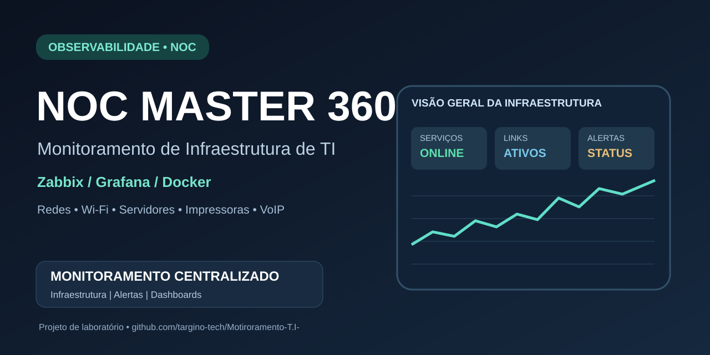

# Imagem de compartilhamento do NOC Master 360°

A arte social do projeto está disponível para configurar a prévia de links do GitHub e do LinkedIn.

**Para configurar a imagem do cartão do repositório:** abra **Settings → General → Social preview → Edit → Upload an image** e envie a versão PNG da arte (1280 × 640 px). A imagem exibida nas redes depende dos metadados Open Graph servidos pelo GitHub; a presença de uma imagem no README, isoladamente, não define a miniatura do link.

No LinkedIn, utilize o [Post Inspector](https://www.linkedin.com/post-inspector/) para solicitar nova leitura do URL após configurar a imagem. Publicações anteriores podem manter a prévia armazenada em cache.
